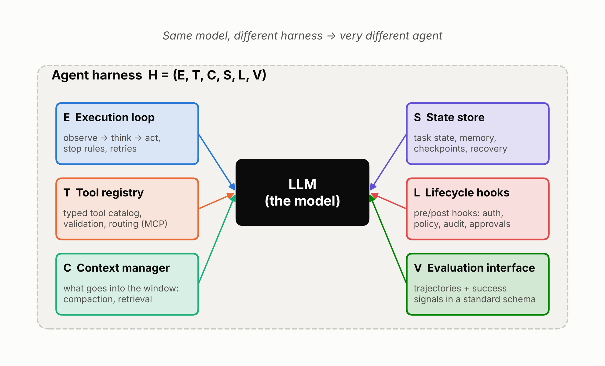
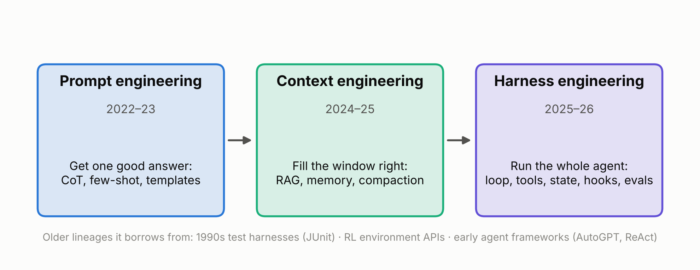
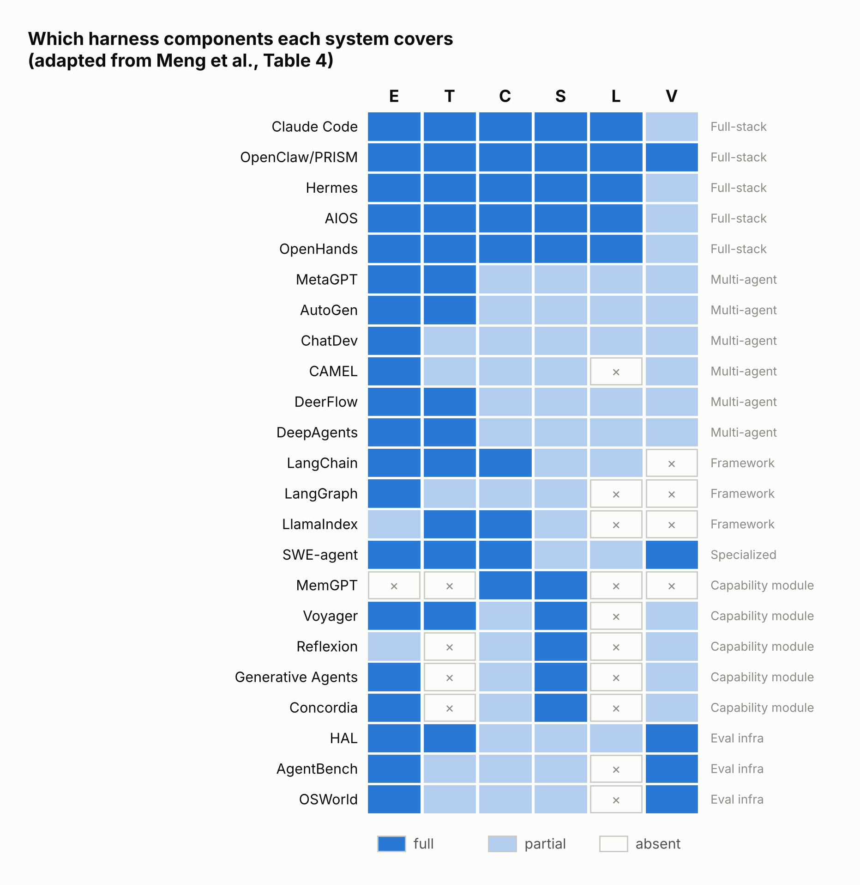
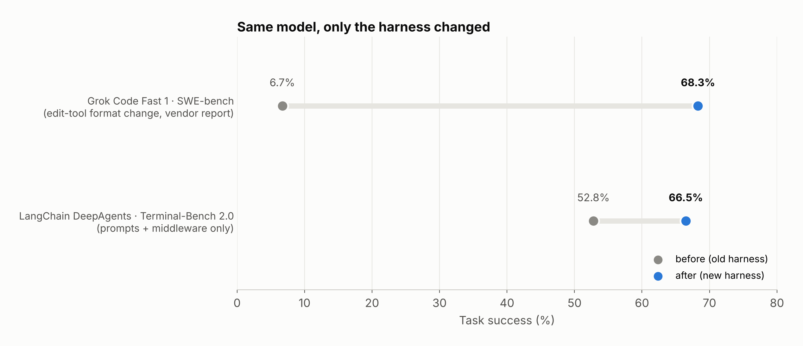
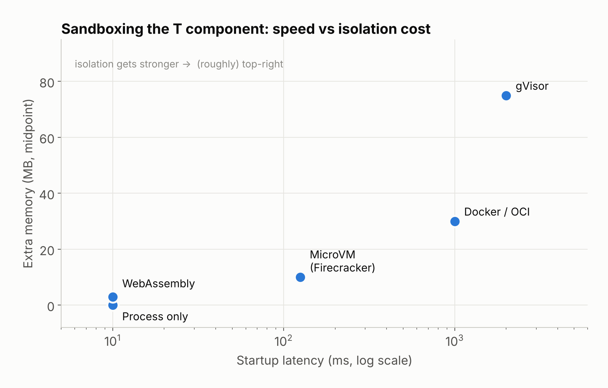
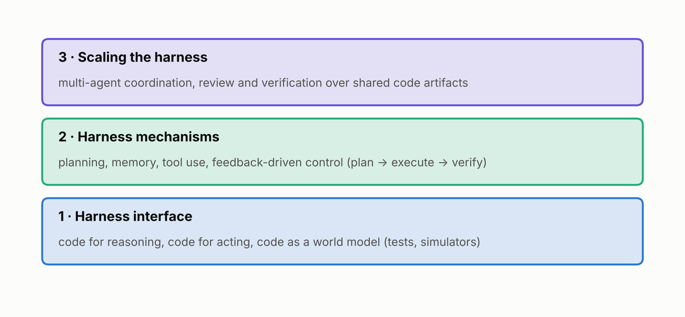
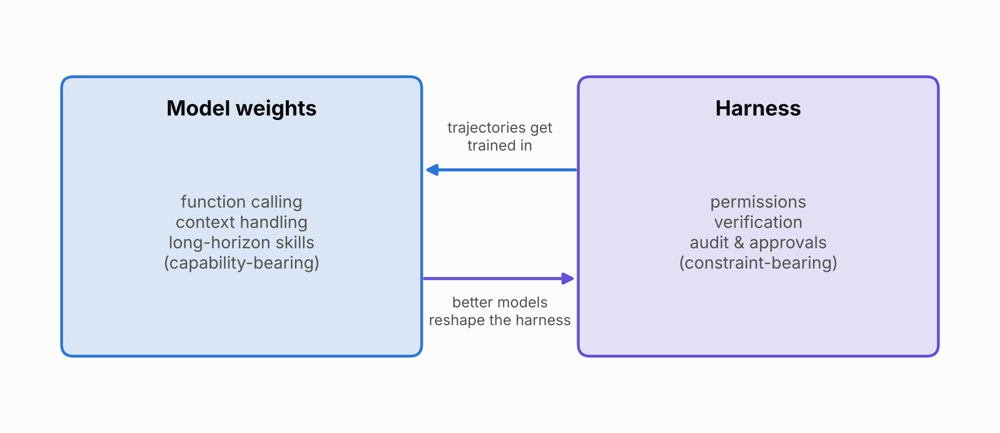
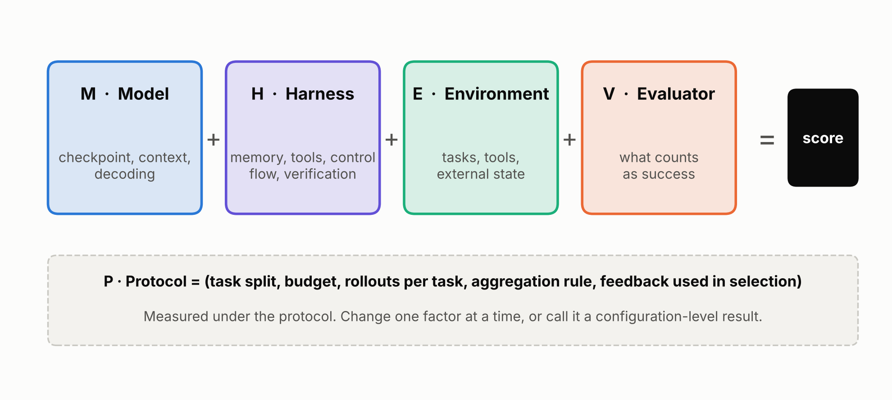
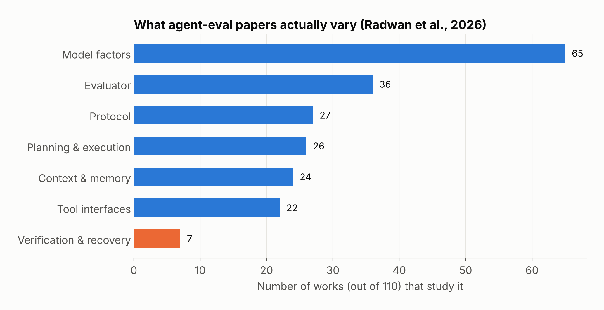

# It's Not Just the Model: A Field Guide to Agent Harness Engineering

*What four 2026 surveys say about the code wrapped around your LLM, and why it might matter more than which model you pick.*

---

## The 10x jump nobody trained for

Here's a number that stuck with me. xAI reported that one of its coding models went from solving about **7% of SWE-bench tasks to about 68%**. It wasn't retrained, and it wasn't a bigger model. They changed the format of the tool the agent uses to edit files.

That's a vendor report, so take the exact figure with some salt. But it isn't a one-off. LangChain took the same coding model on Terminal-Bench 2.0 from **52.8% to 66.5%**, roughly a 26% relative jump. All they changed was prompts and middleware. That moved them from around the top 30 to the top 5 on the leaderboard.

If you've built anything with agents, you've probably felt this already. The model is the engine, but the thing that decides whether the car actually gets anywhere is everything around it: the loop, the tools, what goes into the context, what gets saved, what gets blocked, and what gets logged.

In 2026 that "everything around it" finally got a name in the research literature: the **agent harness**. This article walks through the survey that formalizes it and three companion surveys that push the idea in different directions.

**Papers covered:**

1. **Agent Harness for Large Language Model Agents: A Survey**, Meng, Wang, Chen, et al. (arXiv:2605.29682, May 2026). *Main paper.*
2. **Code as Agent Harness**, Ning et al., 42 authors from UIUC, Meta and Stanford (arXiv:2605.18747, May 2026).
3. **Harness Engineering for LLM Agents: A Survey of Harness Component Taxonomy, Evaluation, and Model–Harness Coevolution**, Li, Wu and Chang (Preprints.org, June 2026).
4. **Harness-Aware Evaluation of LLM Agents: Systems, Benchmarks, and Protocols**, Radwan, Vasilakos and Raza (Preprints.org, Sept 2026).

---

## How we got here: prompt → context → harness

Meng et al. tell the story as three shifts.

- **Prompt engineering (2022–23).** The unit of work was one call. Chain-of-thought, few-shot examples and careful templates were how you got a good answer out of a model.
- **Context engineering (2024–25).** Once agents ran for many steps, the problem became *what's in the window*: retrieval, memory and summarizing old turns so the agent doesn't drown.
- **Harness engineering (2025–26).** Now the agent runs for hours, touches real systems and needs to be audited. The problem is the whole runtime.

They also point out the harness idea isn't new. It borrows from three older lines of work: 1990s software test harnesses like JUnit (a wrapper that runs and checks code), reinforcement-learning environment APIs (a standard contract between agent and world), and early LLM agent frameworks like AutoGPT, which gave us a long list of the ways agents fail.

What I like about this framing is how honest it is about novelty. The authors say plainly that none of the six components is new. The contribution is treating them as **one object** you can study, compare and improve.

---

## The core taxonomy: H = (E, T, C, S, L, V)

This is the heart of the main survey. A harness is a tuple of six parts:

| Component | What it does | Failure mode if missing |
|---|---|---|
| **E: Execution loop** | Runs the observe → think → act cycle, decides when to stop, handles errors and retries | Execution runaway (loops forever, burns budget) |
| **T: Tool registry** | Typed, validated catalog of tools; routes and monitors calls | Tool misuse |
| **C: Context manager** | Decides what enters the context window: compaction, retrieval, priority | Context blowout |
| **S: State store** | Persists task state across turns and sessions; recovery after crashes | State loss |
| **L: Lifecycle hooks** | Pre/post hooks for auth, policy, audit logs, human approval | Unmonitored side effects |
| **V: Evaluation interface** | Records trajectories and success signals in a standard schema | Unobservable behavior |

A couple of details I found useful:

- **E and T are the minimum.** Without a loop there is no multi-step behavior. Without tools the agent can't do anything. Everything else is what turns a demo into something you can run in production.
- **L and V are easy to confuse.** L *controls* what happens (block this call, ask a human). V *records* what happened, in a form a benchmark or dashboard can read.
- The paper formalizes the loop as a **labeled transition system**, which lets them talk about *safety* (nothing bad happens) and *liveness* (the agent eventually finishes). I'm skipping the math here, but it's what lets them compare designs precisely. For example, ReAct is a bare loop, AutoGPT is a monolithic harness, and LangGraph encodes the loop as an explicit graph.

The authors also note that a task's needs scale with its type. A single-turn Q&A bot barely needs more than E, T and C. A software-engineering agent or a multi-agent system needs nearly all six at full strength.

---

## Grading two dozen real systems

The survey then scores real systems against the six components. I redrew their completeness table here:

They group the systems into families:

- **Full-stack harnesses** (Claude Code, OpenClaw, Hermes, AIOS, OpenHands) cover almost everything.
- **Frameworks** (LangChain, LangGraph, LlamaIndex) give you building blocks, but lifecycle hooks and evaluation are mostly up to you.
- **Capability modules** (MemGPT, Voyager, Reflexion, Generative Agents) go deep on one thing, usually memory or state, and skip the rest.
- **Multi-agent systems** (MetaGPT, AutoGen, ChatDev, CAMEL) nail the loop but are partial almost everywhere else.
- **Evaluation infrastructure** (HAL, AgentBench, OSWorld) is, unsurprisingly, strong on V.

The pattern that jumps out is that **V is the weakest column**. In the survey's count, evaluation support is partial or missing in 14 of 22 systems, and most production harnesses only offer flat logs. We're building agents that run for hours and then debugging them with print statements.

---

## The evidence: same model, different harness

The survey leans on a handful of results where the model was held fixed and only the harness changed:

- **SWE-bench, edit format.** Grok Code Fast 1 went from 6.7% to 68.3% from changing the edit-tool format. *(Vendor report; the paper itself lists two slightly different "after" numbers, 68.3% and 70.8%.)*
- **Terminal-Bench 2.0, LangChain DeepAgents.** 52.8% → 66.5% from prompts and middleware.
- **Meta-Harness**, which searches over harness designs automatically, reached 76.4% on Terminal-Bench 2 and +4.7 points on math reasoning.
- **Holistic Agent Leaderboard (HAL).** 21,730 rollouts across nine models and nine benchmarks, for about $40K. Standardizing the evaluation harness cut evaluation time from weeks to hours and removed a lot of implementation bugs. The uncomfortable implication is that some "model failures" in older papers were actually harness bugs.
- **SWE-agent's agent-computer interface** resolved 10.7% more SWE-bench Lite tasks than a plain shell with the same GPT-4 Turbo model. This one comes from Radwan et al.

Not every harness addition helps, though. In one study Radwan et al. cite, adding a verifier moved resolution from 73.0% to 73.2%, basically nothing. Adding a multi-candidate search module dropped it to 71.4%. Li et al. report that rewriting tool descriptions cut the accuracy drop by about 29% when an agent had more than 150 tools to choose from. Meng et al. go further: sometimes removing tools helps more than adding them.

That's essentially an ablation story: **every component has a cost, and more harness isn't automatically better harness.**

---

## Nine open problems (and one I care about most)

Meng et al. list nine challenge areas. In short:

1. **Sandboxing and security**: memory poisoning, and tools that are safe alone but dangerous combined
2. **Evaluation and benchmarking**: environments drift, tasks are ambiguous, and results are tangled up with the harness
3. **Protocol standardization**: MCP for tools, A2A for agent-to-agent
4. **Runtime context management**: attention gets diluted as the window fills up
5. **Knowledge and context engineering**
6. **Tool-use governance**: sometimes fewer tools work better
7. **Memory architecture**
8. **Planning-loop governance**
9. **Multi-agent coordination**

The point they stress is that these are *coupled*. Your context manager and your hooks interact (C↔L). So do your state store and your tools (S↔T). You can't tune one in isolation.

Sandboxing is a nice concrete example of the trade-offs. Here's the cost of each isolation option the survey compares:

A bare process starts in about 10 ms with no overhead but gives you almost no isolation. gVisor gives strong isolation but takes about 2 seconds and 50–100 MB. Firecracker microVMs sit in a sweet spot at about 125 ms and 5–15 MB, which is why you see them in production agent platforms. The survey also cites practitioner setups like Stripe's, where dev boxes spin up in under 10 seconds and the agent gets at most two CI rounds before a human is pulled in. That's an L-component rule written straight into the workflow.

---

## Companion survey 1: Code *is* the harness

Ning et al. (UIUC, Meta, Stanford) take a sharper position. Instead of code being one tool among many, **code becomes the medium the whole harness is built from.** Their taxonomy has three layers:

1. **Harness interface.** Code as a way to *reason* (write a program instead of free-text math), to *act* (call APIs and run commands), and to *model the world* (tests and simulators are executable descriptions of what "correct" means).
2. **Harness mechanisms.** Planning, memory, tool use and feedback loops, often as plan → execute → verify, where execution results drive the next step.
3. **Scaling the harness.** Multiple agents coordinating through shared code artifacts like repos, tests and reviews, the way human teams do.

The appeal is simple: code is **executable, inspectable and stateful**. You can run it, read it and diff it. Natural-language reasoning gives you none of those for free.

---

## Companion survey 2: Will models eat the harness?

Li, Wu and Chang add a time dimension that I think is the most interesting idea across all four papers. The boundary between model and harness keeps moving in both directions:

- **Harness → model.** Things the harness used to do get trained into the weights. Function calling and context handling started as harness tricks and are now native model features.
- **Model → harness.** Better models change what the harness should optimize for.

Their prediction: **capability-bearing** support (helping the model do the task) keeps migrating into weights, while **constraint-bearing** support (permissions, verification, audit) stays outside. Their taxonomy has seven component families: context, tools, state/memory, orchestration, execution environments, verification/guardrails and observability. It maps closely onto Meng's six, with verification and observability split out.

They also frame harness design as a **multi-objective trade-off** across reliability, cost/latency, autonomy, safety and long-horizon continuity. You can't max out reliability under tight cost and latency caps.

---

## Companion survey 3: Your benchmark score isn't a model score

If harnesses matter this much, then leaderboards that only list a model name are misleading. Radwan, Vasilakos and Raza make that argument directly: **a score belongs to a configuration, not a model.** They break any agent result into:

- **M: Model** (checkpoint, context limit, decoding)
- **H: Harness** (memory, tools, control flow, verification)
- **E: Environment** (tasks, tools, external state)
- **V: Evaluator** (what counts as success)

…all measured under a **P: Protocol**: task split, budget, rollouts per task, aggregation rule, and any feedback used while tuning.

Some numbers from that survey that made me rethink how I read leaderboards:

- **7.8%** of SWE-bench Verified patches that were accepted actually failed the full developer test suite. The evaluator was too lenient.
- On AgentRewardBench, rule-based judging underestimated success by up to **18.5%** and changed model rankings.
- On τ-bench, an agent can pass **over 60%** of tasks on a single try while passing **under 25%** when it has to succeed 8 times in a row (pass^8). Reliability and capability are not the same metric.

They also looked at what the 110 papers they reviewed actually vary:

Model factors show up in 65 works, but verification and recovery in only 7. We study the part we can swap easily and mostly ignore the part that catches mistakes.

Their reporting checklist is practical: disclose the full configuration, sweep one factor at a time, report cost and confidence intervals, keep harness search separate from final evaluation, and keep "the model refused" separate from "the harness blocked it."

---

## My two cents

**1. This matches what I see in practice.** Coming from distributed systems work, a lot of this reads like the agent version of things we already do: retries and timeouts (E), API contracts (T), caches and state (C, S), middleware and auth (L), and observability (V). The survey's real value is giving ML researchers and infra engineers a shared vocabulary.

**2. V is the real gap.** The completeness table and the eval survey say the same thing from two angles. Most systems can't produce clean, comparable trajectories, and most papers don't vary the parts that catch errors. If I were picking a project in this space, it would be agent-native observability: tracing, replay and diffs between runs.

**3. Be careful with the headline numbers.** The 10x SWE-bench jump is a vendor report. The main survey is a non-peer-reviewed preprint, and its own text has small inconsistencies: 22 vs. 23 systems, 10 vs. 12 research directions listed, two different "after" numbers for Grok. The six-component split is also proposed, not empirically derived; the authors admit validation is future work. The direction is convincing. The specific figures need more controlled studies.

**4. The coevolution idea is the one to watch.** If capability support keeps moving into the weights, a lot of today's "harness tricks" will be obsolete in a year. Governance won't be. Permissions, approvals, audit and sandboxing will stay outside the model because you don't want the thing being governed to also be the governor. That's where I'd bet long-term engineering effort goes.

**5. Leaderboards should change.** After reading Radwan et al., a leaderboard row that says "Model X: 65%" without a harness, budget and rollout count feels incomplete. HAL is a good step. I'd like to see more benchmarks require a configuration card.

---

## TL;DR

- An **agent = model + harness**, and the harness (loop, tools, context, state, hooks, evaluation) can move results as much as a model upgrade.
- Meng et al. give the cleanest taxonomy, **H = (E, T, C, S, L, V)**, and show most systems are weakest on **evaluation (V)**.
- Ning et al. argue **code** is becoming the substrate the whole harness is built from.
- Li et al. predict **capabilities migrate into models, governance stays in the harness**.
- Radwan et al. remind us a benchmark score describes a **whole configuration**, so report it that way.

---

## References

1. Q. Meng, Y. Wang, L. Chen, et al. *Agent Harness for Large Language Model Agents: A Survey.* arXiv:2605.29682, 2026. Catalog: github.com/Gloriaameng/Awesome-Agent-Harness
2. X. Ning, K. Tieu, D. Fu, et al. *Code as Agent Harness.* arXiv:2605.18747, 2026.
3. J. Li, Y. Wu, Y. Chang. *Harness Engineering for LLM Agents: A Survey of Harness Component Taxonomy, Evaluation, and Model–Harness Coevolution.* Preprints.org 202606.2203, 2026.
4. A. Y. Radwan, A. V. Vasilakos, S. Raza. *Harness-Aware Evaluation of LLM Agents: Systems, Benchmarks, and Protocols.* Preprints.org 202609.2140, 2026.

*All figures are my own redrawings based on the papers above.*
